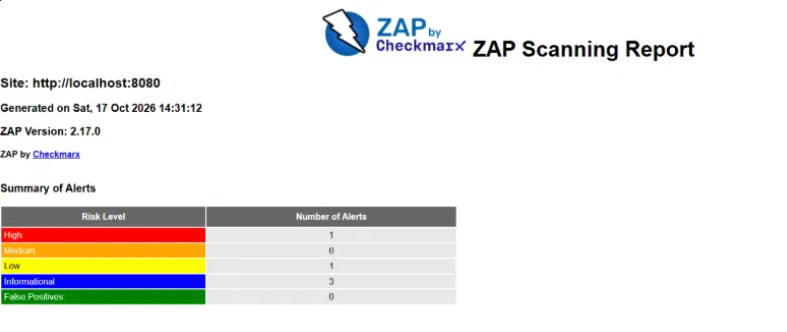
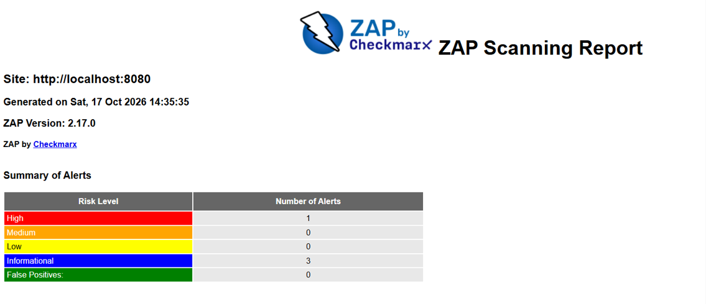

# Gastos API


API REST de controle de despesas em Java 21 e Spring Boot 3. Fiz como desafio de uma mentoria: pegar um projeto simples de gerenciador de despesas e tratar segurança como parte do código, não como etapa final. No fim, o pipeline roda o OWASP ZAP contra a própria API.

Cada usuário cria suas categorias e despesas, filtra por período e só enxerga o que é dele.

## Rodando

Precisa do Docker Desktop aberto.

```powershell
copy .env.example .env
```

Abra o `.env` e troque o valor de `JWT_SECRET` por um segredo aleatório. No PowerShell:

```powershell
$b = New-Object byte[] 48
(New-Object Security.Cryptography.RNGCryptoServiceProvider).GetBytes($b)
[Convert]::ToBase64String($b)
```

No Linux ou Mac, `openssl rand -base64 48` faz o mesmo. Depois:

```powershell
docker compose up --build
```

A primeira subida demora porque baixa as dependências. Quando terminar:

- Health: http://localhost:8080/actuator/health
- Swagger: http://localhost:8080/swagger-ui/index.html

Para testar pelo Swagger: `register`, depois `login`, copie o `accessToken`, clique em **Authorize** e cole só o token. O token dura 15 minutos; se aparecer 401, faça login de novo.

Para parar: `Ctrl + C` e `docker compose down` (use `down -v` se quiser apagar o banco).

## Endpoints

| Método | Rota | Auth | O que faz |
|---|---|---|---|
| POST | `/api/auth/register` | não | Cria o usuário |
| POST | `/api/auth/login` | não | Devolve access token (15 min) e refresh token (7 dias) |
| POST | `/api/auth/refresh` | não | Troca o refresh token por um par novo |
| POST | `/api/auth/logout` | não | Revoga o refresh token enviado |
| GET | `/api/me` | sim | Dados do usuário logado |
| GET, POST | `/api/categories` | sim | Lista e cria categorias |
| PUT, DELETE | `/api/categories/{id}` | sim | Edita e remove uma categoria |
| GET | `/api/expenses` | sim | Lista despesas, com `from`, `to`, `page` e `size` |
| POST | `/api/expenses` | sim | Cria uma despesa |
| GET, PUT, DELETE | `/api/expenses/{id}` | sim | Lê, edita e remove uma despesa |

Exemplo de despesa:

```json
{
  "amount": 45.00,
  "description": "Uber",
  "spentOn": "2026-10-15",
  "categoryId": 1
}
```

O `categoryId` é opcional, mas precisa ser de uma categoria do próprio usuário.

## Decisões de segurança

**Refresh token guardado como hash.** O token que vai para o cliente é aleatório e o banco só guarda o SHA-256 dele. Se alguém vazar o banco, não consegue usar os tokens.

**Rotação com detecção de reuso.** Cada `/refresh` invalida o token usado e entrega um novo. Se um token já usado aparecer de novo, a API assume que ele pode ter sido roubado e revoga todas as sessões daquele usuário.

**404 em vez de 403 para dado de outra pessoa.** Toda consulta filtra pelo `user_id` do token. Se o usuário A pedir a despesa do usuário B, recebe 404, como se ela não existisse. Isso evita IDOR e não confirma que o id existe. Tem teste cobrindo esse caso.

**Login que não entrega se o e-mail existe.** A mensagem de erro é a mesma para e-mail inexistente e senha errada, e a API roda o BCrypt nos dois casos para o tempo de resposta não denunciar a diferença.

**Rate limit.** 10 tentativas por minuto por IP em `/api/auth/**`, para atrapalhar força bruta, e 60 requisições por minuto por usuário nas outras rotas. Passou do limite, volta 429 com `Retry-After`. Escrevi o limitador à mão (janela fixa, em memória) para entender como funciona, e ele tem teste unitário, inclusive com várias threads.

**Validação e erros.** Bean Validation nas entradas e respostas de erro em JSON, sem stack trace.

**Headers.** Além dos que o Spring Security já manda, a API envia CSP restritiva (exceto no Swagger UI), Referrer-Policy, Permissions-Policy e Cross-Origin-Resource-Policy. Dá para desligar tudo isso com `HARDENING_ENABLED=false`, que uso para gerar o relatório "antes" do ZAP.

**Container.** A imagem roda com usuário sem privilégios e os segredos vêm de variáveis de ambiente.

## Testes

```bash
mvn verify
```

São 23 testes: fluxo de autenticação, reuso de refresh token, logout, acesso a dados de outro usuário, validação, rate limit, headers e payloads de SQL injection. Os de integração usam Testcontainers com um Postgres real, então o Docker precisa estar rodando.

## Pipeline e ZAP

O workflow em `.github/workflows/ci.yml` tem dois jobs. O primeiro compila e roda os testes. O segundo sobe a API com Docker Compose, cria um usuário, pega um token e roda o ZAP API Scan autenticado contra o OpenAPI da própria API. O relatório fica como artefato da execução. Como reproduzir o antes e depois está em [docs/ZAP-ANTES-DEPOIS.md](docs/ZAP-ANTES-DEPOIS.md).

### Resultado do scan

Rodei o ZAP API Scan autenticado duas vezes contra a mesma API. A única diferença é a variável `HARDENING_ENABLED`: o "antes" é a API com os headers extras desligados, o "depois" é com eles ligados.

| Nível | Antes | Depois |
|---|---|---|
| High | 1 | 1 |
| Medium | 0 | 0 |
| Low | 1 | 0 |
| Informational | 3 | 3 |




| Alerta | Risco | Antes | Depois | O que fiz |
|---|---|---|---|---|
| SQL Injection (`PUT /api/categories/{id}`, parâmetro `name`) | High | 1 | 1 | Investiguei: falso positivo (detalhes abaixo) |
| Cross-Origin-Resource-Policy Header Missing or Invalid | Low | 5 ocorrências | 0 | Passei a enviar `Cross-Origin-Resource-Policy: same-origin` |
| A Client Error response code was returned | Info | 59 | 59 | Esperado: o ZAP manda entradas inválidas e a API as rejeita com 4xx |
| Authentication Request Identified | Info | 1 | 1 | Informativo: o ZAP reconheceu o endpoint de login |
| Non-Storable Content | Info | sistêmico | sistêmico | Esperado: as respostas saem com `Cache-Control: no-store` |

**Sobre o SQL Injection.** Por ser o alerta mais grave, fui investigar em vez de ignorar. O ZAP usou o payload `ZAP AND 1=1 --` no campo `name` da edição de categoria. Todas as consultas ao banco passam por Spring Data com parâmetros e não há SQL montado por concatenação em lugar nenhum do código (a única `@Query` usa parâmetro nomeado). Escrevi o teste `SqlInjectionTest`, que envia esse payload e outros clássicos (`' OR '1'='1`, `'; DROP TABLE ...`) e confere que são gravados como texto comum, sem afetar a tabela nem os dados de outros usuários. Por isso classifico como falso positivo.

Minha hipótese para o motivo do alerta: o detector compara as respostas de `AND 1=1` e `AND 1=2`, e o ZAP também testa o `DELETE` da mesma categoria durante o scan. Se a categoria some no meio, a resposta muda de 200 para 404 sem relação com SQL. Isso é hipótese minha; o que comprovei foi a revisão das consultas e o teste.

Resumo honesto do "depois": o scan não zerou. Corrigi o que era real (o header que faltava) e documentei o que não era.

## Limitações

Esta API é um projeto de portfólio e não está pronta para receber tráfego real do jeito que está. O que eu mudaria antes disso:

- O rate limit fica na memória de uma instância. Com mais de uma réplica, o contador precisaria ficar no Redis.
- Não há HTTPS na aplicação. Ela espera estar atrás de um proxy reverso que faça o TLS.
- O Swagger está aberto. Em produção eu desligaria.
- O access token não pode ser revogado antes de expirar (15 minutos). Só o refresh token é revogável.
- Não tem confirmação de e-mail, recuperação de senha nem papéis de acesso.

## Estrutura

```
src/main/java/com/navas/gastosapi/
├── auth/        registro, login, refresh, logout e JWT
├── user/        usuário e /api/me
├── category/    categorias
├── expense/     despesas
├── ratelimit/   limitador de requisições
├── config/      segurança, OpenAPI e propriedades
└── common/      exceções e tratamento global de erros
```

Stack: Java 21, Spring Boot 3.5, Spring Security, JPA, PostgreSQL, Flyway, jjwt, springdoc, JUnit 5, Testcontainers, Docker Compose, GitHub Actions e OWASP ZAP.
